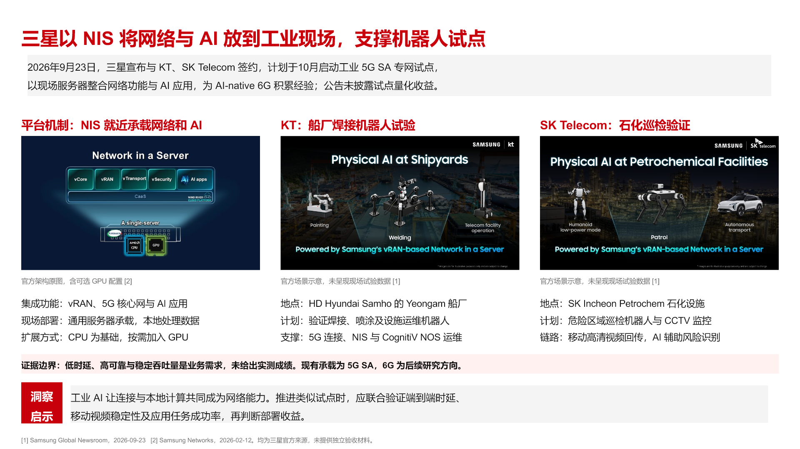
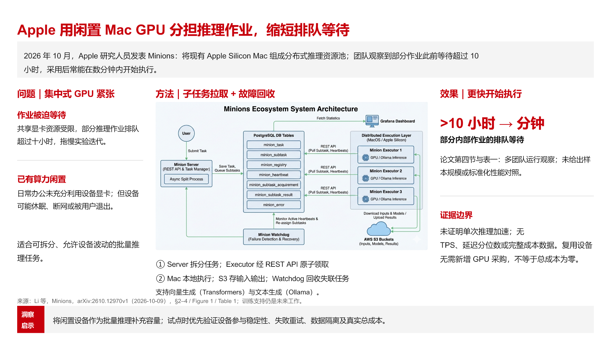

# 能力展示

该 skill 面向一页式技术洞察，不是多页演示模板。它把来源材料压缩为可编辑 PowerPoint，并保留可验证事实与结论之间的边界。

| 输入类型 | 推荐故事线 | 主要交付 |
| --- | --- | --- |
| 技术论文 | 问题 → 方法 → 效果 | 一页研究洞察、原图或可编辑机制图、量化效果与证据边界 |
| 技术进展、结果或技术新闻 | 按来源事实组织事件概览、关键动作与结果 | 一页事件快报、关键数据、决策启示与已知/未知边界 |

事件快报没有另行规定的固定故事线；表中的组织建议应随来源材料调整。

## 典型页面结构

```text
一句话红色主标题
浅灰事件概览条
┌─────────────── 正文证据区 ───────────────┐
│ 问题 / 背景  │ 方法 / 动作 │ 效果 / 数据 │
└──────────────────────────────────────────┘
红色“洞察启示”标签 + 灰色结论与建议区
```

## 能力点

- 用一句话标题直接总结事件，而不是只写主题名。
- 严格交付一页 PowerPoint 标准宽屏：`13.333 × 7.5 in`，OOXML 尺寸为 `12192000 × 6858000 EMU`；仅有 `16:9` 比例不够。
- 优先复用来源中的原始图表，并给出短图注或来源标识。
- 对技术论文稳定采用“问题 → 方法 → 效果”的证据链。
- 使用确定的企业红灰色值、微软雅黑和 Arial，保持可编辑和可汇报。
- 所有最终显示为多行的文本显式设置 `150%` 行距；自动换行需结合渲染预览人工确认。
- 规范化导出器添加的常规编辑锁，使普通 slide 对象可选择、移动、缩放和组合，文本可编辑。
- 统一颜色放在文本框或段落默认层；清除与默认色重复的 run 级颜色覆盖，使整框改色即时生效。
- 用脚本检查 PPTX 必需部件、标准宽屏物理尺寸、严格单页、无动画时序节点、无常规编辑锁、无冗余 run 级颜色和可检测多行文本的 `150%` 行距。

## 真实交付示例

以下示例来自 2026 年 10 月 16 日的 CCN 快报真实运行，已获准作为资料展示。PPTX 和 PNG 均原样保留最终交付版本，没有为展示重新生成或修改内容；每例附来源说明和针对当前 PPTX 重新运行的结构校验摘要。

### 三星 NIS：用三张官方原图解释工业试点



[下载可编辑 PPTX](./showcase/20261016/samsung-nis/report.pptx) · [打开完整预览](/skill-static/create-single-page-tech-report/showcase/20261016/samsung-nis/preview.png) · [来源与证据边界](./showcase/20261016/samsung-nis/source.md) · [校验摘要](./showcase/20261016/samsung-nis/validation.md)

这份事件快报把 NIS 平台架构、KT 船厂试点和 SK Telecom 石化巡检并列展示，复用三张三星官方原图；标题、概览、技术解释和底部洞察保留为原生可编辑对象。它明确区分计划与实测：公告安排 2026 年 10 月启动试点，未提供试点量化收益；低时延、高可靠与稳定吞吐量是业务需求。

来源为 [Samsung Global Newsroom 公告](https://news.samsung.com/global/samsung-at-the-forefront-of-koreas-ai-ran-projects-with-kt-and-sk-telecom) 与 [Samsung Networks 的 NIS 架构介绍](https://www.samsung.com/global/business/networks/insights/blog/0211-where-network-infrastructure-evolves-into-enterprise-edge-ai-platform-samsung-network-in-a-server/)。

### Apple Minions：用论文架构原图串联问题、方法与效果



[下载可编辑 PPTX](./showcase/20261016/apple-minions/report.pptx) · [打开完整预览](/skill-static/create-single-page-tech-report/showcase/20261016/apple-minions/preview.png) · [来源与证据边界](./showcase/20261016/apple-minions/source.md) · [校验摘要](./showcase/20261016/apple-minions/validation.md)

这份论文洞察采用“问题 → 方法 → 效果”，以论文 Figure 1 作为方法区视觉锚点，并用可编辑文字解释任务拉取和故障回收。效果只表达部分内部作业的排队等待由超过 10 小时变为数分钟，没有把运行观察扩展为单次推理加速或标准化吞吐测试，也没有把无需新增 GPU 采购写成零总成本。

来源为 [Minions 论文 arXiv:2610.12970v1](https://arxiv.org/html/2610.12970v1)，对应 §2–4、Figure 1 和 Table 1。

可编辑性与视觉检查范围详见各例校验摘要。[制作规则](https://github.com/Real-UtopiaNo/create-single-page-tech-report/blob/main/SKILL.md) 与 [自动校验实现](https://github.com/Real-UtopiaNo/create-single-page-tech-report/blob/main/scripts/validate_single_page_report.py) 可用于进一步复核。

## 能力边界

- 不根据缺失信息补造数据、日期、主体或对比结论。
- 自动校验不判断标题是否准确，也不判断图表是否真正支撑结论。
- 结构校验通过只说明脚本覆盖的 OOXML 条件成立；还需打开或渲染 PPTX，并人工检查普通文字和图形的编辑体验。
- 不保证在没有 PowerPoint 生成能力的 Agent Runtime 中完成 `.pptx` 创建。
- 不把渲染 PNG 当作可编辑 PowerPoint 的替代品。
